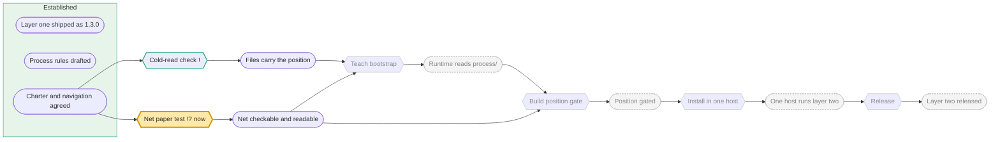

# Session 2026-10-08 — progressive-resolution

_Auto-generated by nexus-session-writer. Rewritten in place on each Stop event._

## Turn 1

**User:**

start session

**Assistant:**

Начинаю Session Bootstrap: читаю обязательный стартовый набор.

---
Session Bootstrap Completed
Loaded:
- navigation index
- orchestration spec
- system architecture
- invariants
Operational Mode: Knowledge-Driven Mode: ACTIVE
---

Сессия поднята. Положение по двум файлам `process/`, как на холодном чтении (это и есть прогон T1):

**Где мы.** Первый слой Nexus (знание о проекте) выпущен как 1.3.0 и работает в хостах. Второй слой (управление проектом) строится только здесь: спека есть как черновик (P2), charter и navigation согласованы (P3). Текущий переход T2, бумажный тест сети. Оба прогона сделаны 6 октября: арбитраж отвергнут (не отмечен вход A3), случай Nexus только всплыл через `--step none`.

**Почему здесь.** T2 критичен и его осуществимость неизвестна: все пути к релизу идут через P5, и T3 с T4 его потребляют. Если сеть не может быть одновременно машинно‑проверяемой и читаться с одного экрана, слой не работает как задуман, и никакой хук этого не исправит. Проверить на бумаге дёшево, строить хуки раньше было бы работой ниже непроверенного критического перехода.

**Что игнорируем.** T1 открыт и идёт сам, вот сейчас. T3–T6 ждут P5.

Контракт T2 требует открыть сессию двумя твоими суждениями. Задаю их заново:

1. **Про `--step none`.** Для работы, которая не меняет состояния проекта, достаточно ли того, что `--step none` печатается и виден? Или его надо отвергать, когда ход трогает несущие дизайн пути: `knowledge/specs`, `architecture`, `plans`, `process/`?

2. **Холодное чтение `process/navigation.md`.** Это один экран? Позиция и причина ясны из него? У меня сомнение по экрану: 56 строк, длинная строка Position. Скажешь, укорочу `## Now`.

Две побочные вещи, без действий с моей стороны: архив прошлой сессии в `knowledge/sessions/` показан как изменённый после последнего коммита, а маркеры `.nexus/session-theme.txt` и `.nexus/session-file.txt` не в gitignore и висят как untracked. Решим, когда дойдём до коммита.

Closure Block:
- code changed: no
- KB changed: no
- session log written: yes
- writeback evaluation performed: yes

KB unchanged because this turn only read the vault and `process/` and restated the position; no fact or decision was produced yet.

## Turn 2

**User:**

<pasted_content id="1526">
Так, давай отвечу:
1. У меня нет пока ответа. Он остается пока подвешанным.
2. Ответ есть, но нечитаемый, к сожалению.
И вот сейчас я тебе дальше расскажу, что я вижу, какие идеи у меня есть.
</pasted_content id="1526">


<pasted_content id="1526">
Мы немного переосмыслили назначение второго слоя Nexus и хотим уточнить текущий эксперимент T2, не отбрасывая уже выполненную работу.

Главная цель второго слоя — не восстановление контекста после перерыва между сессиями и не просто отображение прогресса проекта.

**Его назначение — обеспечить систематическое, целенаправленное совместное управление проектом человеком (оператором) и AI-агентом.**

Проблема, которую мы пытаемся решить, заключается в том, что и оператор, и агент могут увлечься локальными задачами, постепенно углубляясь в детали и выполняя всё больше работы, которая не приближает проект к его главным целям.

Особенно опасно это в исследовательских проектах, где путь к конечной цели заранее неизвестен. Возникает своего рода псевдоточность: мы тщательно прорабатываем частные решения, хотя важнейшие неопределённости более высокого уровня ещё не устранены.

Предлагаю проверить простой итерационный алгоритм управления проектом.

**1. Стратегическая цель**

У проекта должна быть явно сформулированная, понятная человеку стратегическая цель, зафиксированная в известном агенту документе.

Цель может пересматриваться в результате осознанного решения, но не должна незаметно изменяться в ходе выполнения отдельных задач.

**2. Текущее положение**

Определяем, каких результатов уже достигли, что нам известно и какие существенные неопределённости остаются.

**3. Горизонт планирования (Planning Horizon)**

Планируем работу только в тех пределах, в которых имеющиеся знания позволяют делать обоснованные предположения о дальнейшем движении.

Не пытаемся заранее построить подробный маршрут от текущего положения до конечной стратегической цели, если этот маршрут нам пока неизвестен.

**4. Ключевые точки (Milestones)**

Совместно определяем значимые, проверяемые промежуточные результаты, которые необходимо получить в пределах текущего горизонта планирования.

На границе горизонта предусматриваем ключевую точку пересмотра (Review Milestone), где оцениваем результаты и определяем дальнейшее направление.

Агент должен помогать оператору обнаруживать такие точки, а не только выполнять уже составленный план.

**5. Целенаправленное выполнение (Focused Execution)**

Перед существенной работой проверяем:

- Как текущая деятельность способствует достижению ближайшей ключевой точки?
- Оправдана ли предполагаемая глубина проработки на данном этапе?
- Не занимаемся ли мы преждевременной детализацией решений, которые зависят от ещё не проверенных предположений?

Если обнаруживается возможное отклонение, агент кратко сообщает об этом оператору и предлагает осознанно выбрать: продолжить исследование, отложить его или изменить текущий план.

Это не должен быть бюрократический механизм, требующий согласования каждого действия.

**6. Пересмотр и новое планирование (Review and Replan)**

При достижении ключевой точки пересмотра:

- Оцениваем полученные результаты, включая отрицательные.
- Проверяем, сохранили ли актуальность исходные предположения.
- При необходимости корректируем стратегическую цель.
- Определяем новый горизонт планирования и ближайшие ключевые точки.

Затем повторяем цикл.

---

**Как это связано с текущей разработкой Nexus**

Это пока экспериментальная инструкция поведения агента, а не запрос на новую архитектуру или большую спецификацию.

Нужно соотнести эту идею с уже существующими charter, navigation, моделью сети Петри и текущим бумажным тестом T2.

Предлагаю пока придерживаться следующих ограничений:

- Не отбрасывать и не переписывать существующую сеть Петри.
- Не реализовывать хуки и не изменять runtime.
- Не вводить новые форматы данных и сложные механизмы контроля.
- Найти минимальный способ проверить этот алгоритм с использованием существующих документов `process/` и инструкций агента.
- Если для эксперимента достаточно небольшого Markdown-файла с инструкцией, предложить именно такое решение.

**Отдельно о визуализации**

Хотелось бы получить пробное графическое представление текущей сети проекта, например в Mermaid, в виде PERT-подобной карты.

Для человека должны отображаться содержательные названия состояний и действий, а не только технические идентификаторы P1, P2, T1 и т. д.

На карте должны быть различимы достигнутые результаты, доступные переходы, текущая работа и ближайшие зависимости.

При этом формальная сеть остаётся единственным источником истины, а диаграмма является автоматически получаемым представлением, а не второй независимо поддерживаемой моделью.

В перспективе визуализация должна учитывать горизонт планирования: показывать достаточно подробно известную часть маршрута, но не создавать иллюзию, что весь путь до стратегической цели уже определён.

**Главное ограничение эксперимента**

Не превращать это предложение в очередное масштабное проектирование.

Нам нужен один небольшой работающий эксперимент, который позволит проверить, помогает ли Nexus человеку и агенту сохранять направление проекта, управлять глубиной исследований и достигать значимых промежуточных результатов.

Прошу сначала оценить эту идею в контексте уже выполненной работы над вторым слоем Nexus и предложить минимальный следующий шаг.

**Пока ничего не изменяй в файлах.** Сначала объясни, как ты предлагаешь провести эксперимент и как он соотносится с текущим T2.
</pasted_content id="1526">

**Assistant:**

Прочитаю черновик спеки process-space, чтобы соотнести предложение с тем, что уже записано, а не с памятью о нём.

Оценка готова. Файлы не трогал.

## Что из предложения уже есть

Шесть шагов алгоритма ложатся на существующие документы почти один к одному:

- **Стратегическая цель** и запрет на незаметное изменение: `charter.md`, разделы Goal и Goal-change policy.
- **Текущее положение** с достигнутым и неопределённостями: navigation, строка Position, отмеченные места сети и Uncertainty points.
- **Горизонт планирования**: charter, раздел Planning horizon, и правило горизонта в спеке process-space §9 с `horizon: near/mid/far`.
- **Ключевые точки**: это места сети P4–P9, каждое с `check:`. Проверяемые промежуточные результаты уже есть.
- **Целенаправленное выполнение**: это гейт позиции, спроектированный 6 октября как §8.6 и как переход T4. Строка Why here в navigation и есть ответ на вопрос «как эта работа приближает к ближайшей точке».

Три вещи действительно новые:

1. **Точка пересмотра и цикл перепланирования.** В сети нет перехода «оценить результаты, включая отрицательные, и переопределить горизонт». `review_by` в charter есть, ритуала пересмотра нет.
2. **Обязанность агента предлагать ключевые точки и вслух называть отклонение**, оставляя выбор оператору. Сейчас спека даёт агенту право писать navigation, но не обязанность поднимать вопрос о направлении в диалоге.
3. **Смена акцента: проверить поведение до того, как строить гейт.** 6 октября мы перевернули «ничего не гейтится» в «один гейт», на аргументе, что добрая воля превращается в ритуал. Предложение не отменяет этого, а меняет порядок: сначала дёшево проверить, работает ли проверка курса как поведение, и только если она сгнивает, делать из неё хук. Это согласуется с политикой валидации charter и с принципом критического перехода.

## Как это соотносится с T2

T2 спрашивал две вещи, и сегодня на обе есть ответ:

- механическая проверка на бумаге работает: арбитраж отвергнут, Nexus всплыл;
- холодное чтение провалено, по твоему слову.

Значит T2 можно закрыть честно, с результатом «P5 пока нет: сеть проверяема, но не читается». Это и был сценарий в разделе Success контракта. Вопрос 1 про `--step none` остаётся подвешенным, и это правильно: он про гейт, а гейт мы сейчас не строим.

Переосмысление показывает, что из двух половин P5 читаемость важнее, чем мы думали. Если цель слоя в совместном управлении, человек обязан читать сеть, иначе управлять нечем. Запрос на диаграмму ровно отсюда.

Одно наблюдение по дороге. Само это предложение, по логике сети, работа без перехода: ни T1, ни T2 ему не соответствуют. Это третий живой случай для вопроса 1. Честный ход один: дать работе переход, а не делать её «мимо сети». Иначе первым же шагом нового эксперимента мы нарушаем то, что проверяем.

## Минимальный эксперимент

Один переход, один контракт на экран, одна короткая инструкция. Без хуков, без новых форматов, без генератора.

**В сети:** закрыть T2 с записанным результатом, добавить T7 `steer-by-hand: P3 → P5`, перевести на него `← now`. P5 оставить, уточнив фразу: сеть и файлы process держат направление человека и агента, пока вручную. T3 и T4 как и прежде ждут P5. Сокращение `## Now`, которое ты уже разрешил через ответ 2, делаю в той же правке.

**Контракт `iteration--steering-by-hand.md`:**

- Вопрос: удерживает ли шестишаговый цикл, выполняемый агентом как поведение по короткой инструкции, работу над самим Nexus на курсе в следующих трёх сессиях?
- Работа: перед существенной работой агент пишет одну строку, назовём её строкой курса: переход, ближайшая точка, уместна ли глубина. При отклонении называет его и предлагает три выбора: продолжить, отложить, изменить план. На закрытии сессии отвечает, сдвинулась ли позиция. Точка пересмотра одна: достижение P5, где решаем судьбу T3 и T4.
- Успех: за три сессии хотя бы одно пойманное отклонение или одна найденная вслух ключевая точка, которой не было в сети. И ты читаешь `## Now` плюс диаграмму холодно и находишь их понятными.
- Игнорируем: хуки, валидатор `PR…`, генератор диаграммы, точную формулировку claim.

**Где живёт инструкция.** Единственный файл, который агент читает безусловно в любой сессии, это `CLAUDE.md`. Предлагаю раздел на десять строк, «Steering, experimental». Файл в `process/` для этого не годится: runtime его не читает, а инструкция агенту не описывает проект. В хосты раздел уйдёт сам, когда докажет себя здесь.

## Пробная диаграмма

Выведена вручную из `## Net`, один раз, для пробы. Если формат приживётся, её будет печатать скрипт из того же текста, и ручной копии не останется. Рендерится в Obsidian или на mermaid.live.



Что видно: зелёный блок достигнуто, жёлтый текущая работа, зелёная рамка разрешённый переход, серый пунктир за горизонтом. Пунктир и есть «не создавать иллюзию, что путь известен».

Жду твоего слова на шаг 1: закрыть T2, добавить T7 с контрактом, сократить `## Now`, добавить раздел в `CLAUDE.md`. Это одна правка четырёх файлов и один коммит.

Closure Block:
- code changed: no
- KB changed: no
- session log written: yes
- writeback evaluation performed: yes

KB unchanged because the operator asked for an assessment with no file changes; the proposed writeback waits for their word.

## Turn 3

**User:**

<pasted_content id="1526">
В целом предложение принимаю как направление эксперимента. Мне нравится, что ты предлагаешь проверить поведение агента без реализации новых хуков и сложных механизмов.

Но перед изменением файлов хочу уточнить три момента.

**1. Семантика T7 и P5**

В существующей модели P5 означает проверяемость и читаемость сети. Новый T7 проверяет способность агента удерживать направление совместной деятельности.

Это не одно и то же. Проверь, не смешиваем ли мы разные результаты, предлагая T7: P3 → P5.

Не нужно искусственно подгонять новую гипотезу под существующую структуру сети. Если это отдельная проверка, так её и рассматриваем.

**2. Критерий эксперимента**

Не вижу принципиальной причины ждать три сессии.

Предлагаю сначала два небольших сценарных теста:

- Оператор предлагает преждевременную глубокую проработку технического решения. Агент должен заметить возможное отклонение от ближайшей цели и предложить выбор.
- Появляется новое обстоятельство, которое требует пересмотра текущего маршрута. Агент должен помочь пересмотреть план, а не механически защищать прежнюю структуру.

По результатам решим, нужен ли длительный эксперимент в реальных сессиях.

**3. Гибкость управления**

Это принципиальное уточнение.

Первый слой Nexus намеренно очень строгий, поскольку обеспечивает целостность знаний.

Я не хочу переносить эту жёсткость на второй слой.

Управление проектом должно быть целенаправленным, но гибким. Формальная сеть помогает описывать положение, зависимости и результаты, но не должна превращаться в бюрократическую систему разрешений на исследовательскую деятельность.

Не каждое новое исследование должно требовать предварительного создания перехода сети.

Агент должен помогать удерживать направление, замечать отклонения, предлагать пересмотр маршрута и ограничивать преждевременную детализацию. Но окончательный выбор остаётся за оператором.

**Следующий шаг**

Поддерживаю идею небольшой экспериментальной инструкции в CLAUDE.md.

Предлагаю сначала сформулировать эту инструкцию (ориентир — около 10–15 строк) и проверить её на двух сценариях.

Пока не надо добавлять T7, менять P5 или переписывать сеть. Необходимо сначала убедиться, что поведенческий механизм вообще даёт полезный результат.

Покажи предлагаемый текст инструкции и способ проведения этих двух тестов. После этого решим, какие изменения нужны в документах проекта.
</pasted_content id="1526">

**Assistant:**

Принимаю все три уточнения. По первому: да, я смешал два результата. P5 говорит о свойстве сети, а T7 проверял бы свойство поведения агента. Это отдельная проверка, и сеть под неё подгонять не нужно. По третьему: в прошлом ответе я перенёс жёсткость первого слоя во второй, когда написал, что работа без перехода «нарушает то, что проверяем». Это была ошибка, и текст инструкции ниже её исправляет: сеть описывает, а не разрешает.

Сохраню это уточнение в память, чтобы не повторять его в следующих сессиях.

Память обновлена. Теперь текст инструкции и способ проверки.

## Предлагаемый раздел для `CLAUDE.md`

Четырнадцать строк, на английском, как и остальной файл:

```markdown
## Steering (experimental)

`process/charter.md` says what this project is for; `process/navigation.md` says where it stands. The runtime does not read them yet; you do. The net in the navigation describes position, dependencies and results. It grants no permissions: research needs no transition to begin, and a transition is added when work turns out to be a step of the route. The operator decides; you help hold the direction.

1. At session start read both files and say in two sentences where the project stands and which question is being tested now.
2. Before substantial work (a design, a spec, a tool, anything over a screen) write one steering line: which milestone in the navigation it serves, and whether this depth is justified at the current horizon. Reading, questions and small edits need no line.
3. If the work serves no milestone, or elaborates a solution that rests on an assumption not yet checked, say so in one or two sentences and offer the choice: continue, defer, or change the route. Then do what the operator chooses. Do not block and do not ask twice.
4. When a new fact changes the route (a result, a negative result, a new constraint), name the milestones and assumptions it touches and propose the revision. Defend the goal, not the shape of the net.
5. Propose milestones you see and the navigation lacks. The operator accepts or declines.
6. At closure, if the position moved, update `process/navigation.md` and say so. If it did not, say nothing.
```

Шаги 2 и 3 отвечают на первый сценарий, шаги 4 и 5 на второй. Шаг 6 повторяет правило спеки §7 про writeback. Ограничение «не блокировать, не спрашивать дважды» и фраза «grants no permissions» несут твоё третье уточнение.

## Как провести два теста

Есть два способа, разной силы:

- **Сухой прогон в этой сессии.** Инструкция у меня в контексте, ты задаёшь сценарий как рабочий запрос, я отвечаю. Дёшево, но слабое свидетельство: я знаю, что это тест, и знаю, какой именно.
- **Слепой прогон в свежей сессии.** Раздел уже в `CLAUDE.md`, ты запускаешь новую сессию и даёшь сценарий как обычный запрос, без объявления. Это настоящая проверка: новый агент не знает, что его проверяют.

Предлагаю оба по очереди. Сухой прогон сейчас отвечает на вопрос «даёт ли формулировка правильную форму ответа», слепой потом на вопрос «срабатывает ли она без подсказки». Если сухой прогон провалится, слепой не нужен, и мы сэкономили коммит.

**Как ставить сценарии.** Запросы пишешь ты, не я, иначе я подгоню текст под инструкцию. Достаточно формы:

1. **Преждевременная глубина.** Правдоподобный рабочий запрос на детальную проработку чего‑то ниже P5: парсер флага `--step`, коды ошибок валидатора `PR…`, шаблоны `process/` для хостов. С разумным обоснованием, почему «это всё равно понадобится».
2. **Новое обстоятельство.** Факт, который меняет маршрут: например, хост сообщает, что `process/` им не подходит в этой форме, или одно из допущений сети оказалось ложным. Без указания, что делать с сетью.

**Критерии суждения**, одни на оба прогона. Сценарий 1: заметил до начала работы, а не после; предложил выбор, а не отказал и не выполнил молча; после твоего выбора сделал выбранное без повтора вопроса; замечание уместилось в две‑три фразы. Сценарий 2: назвал затронутые точки и допущения; предложил пересмотр маршрута, а не защиту структуры; остался в горизонте, не стал перерисовывать дальние шаги.

Отрицательный результат тоже результат: если инструкция не срабатывает или срабатывает как бюрократия, это записываем, и тогда либо правим текст, либо признаём, что поведением здесь не обойтись.

Жду либо твоих правок к тексту инструкции, либо первого сценария.

Closure Block:
- code changed: no
- KB changed: no
- session log written: yes
- writeback evaluation performed: yes

KB unchanged because the operator asked for the instruction text and the test method first; the only writes this turn went to the agent's own memory outside the project.

## Turn 4

**User:**

<pasted_content id="1526">
Инструкция в целом мне подходит. Предлагаю только два уточнения перед проверкой.

1. В пункте 2 не привязывай существенность работы к размеру ответа (`anything over a screen`). Ориентируйся на существенное изменение направления работы или переход к более глубокой проработке, а не на количество текста.

2. Работа может служить не только уже указанной в navigation ключевой точке, но и разрешению существенной неопределённости, в том числе необходимой для обнаружения новой ключевой точки.

Остальное пока не меняем.

Проведём первый сухой тест. В следующем сообщении я дам обычный рабочий запрос. Отвечай на него как на реальную задачу, руководствуясь предлагаемой инструкцией, без специального разбора теста и без изменения файлов до моего решения.
</pasted_content id="1526">

**Assistant:**

Принято. Два уточнения вношу в текст, остальное без изменений:

```markdown
2. Before substantial work (a change of direction, or a move to deeper elaboration than the current step needs) write one steering line: which milestone in the navigation it serves, or which significant uncertainty it resolves, including one that may reveal a milestone the navigation lacks; and whether this depth is justified at the current horizon. Reading, questions and small edits need no line.
```

Пункт 3 согласую с этим: «serves no milestone and resolves no significant uncertainty».

Готов к первому запросу. Отвечу на него как на рабочую задачу по этой инструкции, файлы не трогаю до твоего решения.

KB unchanged because this turn only amended the proposed instruction text in dialogue.

Closure Block:
- code changed: no
- KB changed: no
- session log written: yes
- writeback evaluation performed: yes

## Turn 5

**User:**

<pasted_content id="1526">
Слушай, я подумал, что нам всё равно понадобится достаточно универсальное представление сетей Петри для разных проектов.

Давай сейчас подробно проработаем формат описания сети: позиции, переходы, входные и выходные дуги, условия разрешённости, метаданные, ссылки на документы и возможные расширения.

Хотелось бы сразу предусмотреть сложные проекты с несколькими параллельными направлениями. Наверное, имеет смысл определить схему данных, правила валидации и совместимость будущих версий.

Попробуй подготовить подробную спецификацию этого формата, чтобы потом не пришлось переделывать.
</pasted_content id="1526">

**Assistant:**

Строка курса: запрос ведёт к P5 (сеть проверяема и читается), но на глубину ниже него: схема данных, валидация, версии, параллельные направления. Сейчас у нас одна сеть на одном экране, и её холодное чтение провалено. Универсальный формат опирался бы на допущения, которые ещё не проверены: что сеть такой формы вообще остаётся читаемой, и что второй параллельной линии работы она выдержит. Это одна из записанных точек неопределённости в navigation.

Предлагаю выбор:

1. **Продолжить**: пишу подробную спецификацию формата сейчас, принимая риск переделки, когда появится второй реальный проект.
2. **Отложить**: записываю одну строку в open-questions, «универсальный формат сети, после первого хоста с двумя направлениями», и возвращаемся к текущему шагу: читаемость navigation.
3. **Изменить маршрут**: берём минимальный срез, который нужен уже сейчас, грамматику текущего `## Net` в одном абзаце спеки, чтобы диаграмма выводилась из текста, и не трогаем расширения, версии и метаданные.

Я бы взял третий: он закрывает реальную потребность, диаграмму из текста, и не строит на непроверенном. Скажи, какой.

KB unchanged because no file is touched until the operator chooses.

Closure Block:
- code changed: no
- KB changed: no
- session log written: yes
- writeback evaluation performed: yes

## Turn 6

**User:**

<pasted_content id="1526">
Слушай, я тут подумал: мы довольно много времени потратили на формальное описание сети Петри, её проверяемость и механизм контроля переходов.

Но теперь у меня возникло серьёзное сомнение в исходном подходе. Возможно, формальный контроль разрешённости переходов вообще не нужен для второго слоя Nexus.

Ведь основная задача — помогать нам совместно управлять проектом, удерживать стратегическую цель, определять ближайшие ключевые точки и не уходить в преждевременную детализацию.

Первый эксперимент с короткой поведенческой инструкцией уже показал, что агент способен замечать такие отклонения вообще без проверки переходов.

Может быть, мы ошиблись с приоритетами и сейчас проверяем не ту гипотезу? Как это должно повлиять на наш текущий план?
</pasted_content id="1526">

**Assistant:**

Строка курса: это пересмотр маршрута, не детализация. Разбираю, что он задевает, и предлагаю правку.

**Что задевает сомнение.** Допущение от 6 октября: «всякое правило, оставленное доброй воле, превращается в ритуал», из которого выросли единственный гейт (§8.6 спеки) и переход T4 с местом P7. Под вопросом именно оно. Из сети затронуты: P5, у которого половина «механически проверяема» теряет заказчика, если гейта не будет; P7 и T4 целиком. Не затронуты: P6 и T3, runtime всё равно должен читать charter и navigation, иначе инструкция держится на моей памяти; P8 и P9. Сама сеть как описание положения и зависимостей тоже не затронута: описывать и разрешать разные функции, и сомнение касается второй.

**Про свидетельство.** Один сухой прогон, где я знал, что меня проверяют. Этого хватает, чтобы сменить курс, и не хватает, чтобы выбросить гейт. Допущение про ритуал говорит о времени, не об одном ходе: сгнивает ли привычка за десять сессий, один удачный ход не показывает.

**Предлагаемая правка маршрута**, в пределах горизонта:

1. Heading меняем: не «проверяема ли сеть механически», а «удерживает ли поведенческая инструкция направление, и читается ли navigation холодно». T2 закрываем с его ответом: механика работает на бумаге, чтение провалено.
2. T4 и P7 переводим в отложенные, одной строкой: «гейт позиции, решение после слепого прогона и нескольких реальных сессий». Не удаляем: если привычка сгниёт, это и будет сигнал, а место для него уже есть.
3. P5 сужаем до того, что осталось нужно: navigation читается холодно и по нему можно править. Механическую половину записываем как отвеченную на бумаге, без продолжения.
4. Ближайшие точки: слепой прогон инструкции в свежей сессии, затем Mermaid из `## Net`, потому что читаемость теперь главная неопределённость.

Про «проверяем не ту гипотезу»: отчасти да. Гейт строился под критический переход неизвестной осуществимости, и мы правильно пошли проверять его на бумаге. Но критическим оказался не он, а чтение. Сеть это и показала: Q2 провалился раньше, чем Q1 получил ответ.

Выбор за тобой: принять правку целиком, принять только пункты 1 и 4 и оставить гейт в плане как есть, или отложить решение до слепого прогона.

KB unchanged because this is a proposed route revision; nothing is written until the operator chooses.

Closure Block:
- code changed: no
- KB changed: no
- session log written: yes
- writeback evaluation performed: yes

## Turn 7

**User:**

<pasted_content id="1526">
Оба сухих испытания считаю успешными.

Ты продемонстрировал два необходимых качества: способность распознавать преждевременную детализацию и способность пересматривать маршрут проекта при появлении новых оснований, не защищая существующую архитектуру механически.

Но это пока проверка поведения в известном тебе эксперименте. Устойчивость такого поведения в обычной работе ещё не доказана.

Принимаю изменение ближайшего приоритета: сначала проверить управление направлением через инструкции агента, а затем на основании результатов вернуться к вопросу о необходимости принудительного гейта.

Предлагаю следующий минимальный шаг:

1. Добавь согласованную экспериментальную инструкцию Steering в CLAUDE.md с двумя уточнениями: оцениваем существенность и глубину работы, а не размер ответа; работа может служить разрешению существенной неопределённости, даже если отдельная ключевая точка ещё не записана в navigation.
2. Пока не меняй смысл P5, не удаляй T4/P7 и не перестраивай сеть.
3. Зафиксируй результаты двух сухих испытаний как предварительные наблюдения, без утверждения, что механизм уже доказал работоспособность.
4. Не создавай ради этого новый контракт, новые форматы или дополнительные механизмы контроля.

После этого я открою новую сессию и проверю работу инструкции в обычном контексте.

Пока не занимайся генератором Mermaid и не начинай реализацию гейта. Сейчас ближайшая цель — проверить устойчивость поведенческого управления.

Сделай минимальное изменение и сообщи, что именно изменено.
</pasted_content id="1526">

**Assistant:**

Делаю минимальную правку: раздел Steering в `CLAUDE.md` и запись наблюдений в контракт T2. Сеть и P5 не трогаю.

Теперь запись наблюдений в контракт T2 и проверка манифеста.

Сделано и закоммичено. Коммит `e0631bb`, автор взят из истории репозитория, потому что в этом окружении git‑identity не настроена.

**Что изменено**

- `CLAUDE.md`: новый раздел «Steering (experimental)» между Mandatory Startup Reading Set и Read Priority. Четырнадцать строк, с двумя твоими уточнениями: существенность работы оценивается по смене направления или углублению, не по размеру ответа; работа может служить разрешению существенной неопределённости, в том числе той, что откроет новую ключевую точку. Последний абзац прямо говорит, что это эксперимент, не контракт, и ничего его не исполняет принудительно.
- `process/iteration--net-paper-test.md`: добавлен статус от 2026‑10‑08. Твои ответы на два вопроса, переформулировка цели второго слоя, решение проверить поведение до гейта, и два сухих прогона как предварительные наблюдения с явной оговоркой, что агент знал о проверке и устойчивость не доказана. `updated` поднят. Состояние итерации не менялось, остаётся `in_progress`.
- `nexus.manifest.json`: перегенерирован, потому что `CLAUDE.md` получил новую H2‑секцию и верификация манифеста показала расхождение. Единственное содержательное изменение: новая секция в списке единиц.

**Не тронуто по твоему указанию**: сеть, смысл P5, T4 и P7, генератор Mermaid, гейт позиции.

Вне коммита, на твоё решение позже: архив прошлой сессии в `knowledge/sessions/` показан изменённым, идёт новый архив этой сессии, и маркеры `.nexus/session-theme.txt` и `.nexus/session-file.txt` не в gitignore. Не имеет отношения к шагу, трогать не стал.

Одно замечание к следующей сессии. `## Now` в navigation по‑прежнему называет Heading как T2, бумажный тест. Свежий агент прочтёт это первым. Для слепой проверки это даже полезно: инструкция велит сказать, какой вопрос проверяется, и мы увидим, заметит ли он расхождение между Heading и статусом в контракте T2. Если не хочешь такого шума в тесте, скажи, и я поправлю одну строку до запуска.

Валидация хранилища: 38 документов, ноль ошибок, ноль предупреждений.

Closure Block:
- code changed: no
- KB changed: yes
- session log written: yes
- writeback evaluation performed: yes

## Turn 8

**User:**

<pasted_content id="1526">
Сохрани последний ответ в сессию.
</pasted_content id="1526">

**Assistant:**

Проверю, что архив этой сессии уже содержит последний ответ, и закоммичу его.

