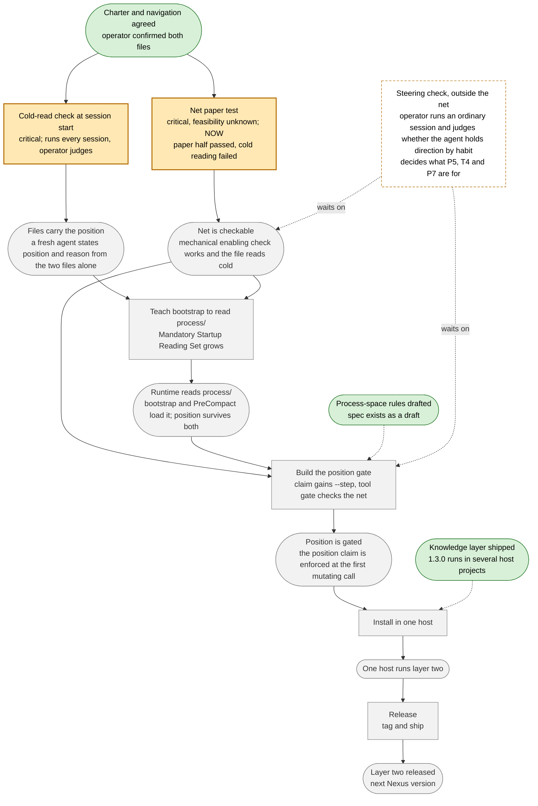

# Session 2026-10-08 — progressive-resolution

_Auto-generated by nexus-session-writer. Rewritten in place on each Stop event._

## Turn 1

**User:**

start session

**Assistant:**

Запускаю Session Bootstrap: читаю обязательный стартовый набор, затем `process/charter.md` и `process/navigation.md`.

---
Session Bootstrap Completed
Loaded:
- navigation index
- orchestration spec
- system architecture
- invariants
Operational Mode: Knowledge-Driven Mode: ACTIVE
---

Где стоит проект (по `process/charter.md` и `process/navigation.md`): первый слой Nexus, знание о проекте, выпущен как 1.3.0 и работает в хостах; второй слой, управление проектом, существует только здесь как черновая спецификация, чартер и навигация, бумажный тест сети (T2) прошёл, но холодное чтение навигации провалилось, поэтому P5 не отмечен. Сейчас проверяется вопрос: удерживает ли стиринг как привычка агента (экспериментальная секция в CLAUDE.md) направление проекта в обычной работе, или нужен гейт; до ответа T4, P5 и форма сети не трогаются.

Готов к задаче.

Closure Block:
- code changed: no
- KB changed: no
- session log written: yes
- writeback evaluation performed: yes

KB unchanged because this turn only performed the mandatory bootstrap reading and stated the position; no work was done.

## Turn 2

**User:**

<pasted_content id="0266">
Слушай, давай вернёмся к проблеме визуализации проектной сети.

Мне по-прежнему неудобно читать список позиций и переходов в navigation.md. Хочу видеть понятный граф продвижения проекта, с названиями задач и результатов вместо P1, P2, T1 и так далее.

Думаю, Mermaid вполне подойдёт для первого эксперимента.

Давай попробуем сделать такую диаграмму для текущего Nexus, чтобы было видно, что уже достигнуто, над чем мы сейчас работаем и какие задачи впереди.
</pasted_content id="0266">

**Assistant:**

Стиринг-строка перед работой: диаграмма сети служит P5 (сеть читается холодно) и задевает точку неопределённости «останется ли сеть одним экраном», то есть милстоун у неё есть. Но в `process/navigation.md` в разделе Ignoring Mermaid-вид сети назван прямо: отложен до результата проверки стиринга, а результата в навигации пока нет. Глубина сама по себе оправдана: один файл, без кода, без изменения формы сети.

Варианты:

1. **Продолжить** как эксперимент: рисую Mermaid-граф текущей сети с названиями вместо P/T, кладу рядом с навигацией, в навигацию ничего не вписываю, пока ты не посмотришь.
2. **Отложить** до результата проверки стиринга, как записано.
3. **Поменять маршрут**: вынести Mermaid-вид из Ignoring и сделать его шагом к P5, тогда я правлю навигацию и рисую.

Если выбираешь 1 или 3, в следующем ходе делаю диаграмму. Моё мнение: 3 честнее, потому что работа всё равно двигает P5, а Ignoring должен отражать то, что мы реально делаем.

KB unchanged because this turn only weighed the request against the navigation and offered the choice; nothing was written.

Closure Block:
- code changed: no
- KB changed: no
- session log written: yes
- writeback evaluation performed: yes

## Turn 3

**User:**

Давай первый вариант

**Assistant:**

Делаю диаграмму. Сначала смотрю черновую спецификацию process/, чтобы файл лёг по её правилам.

Готово. Файл `process/view--net.md` написан, навигация и спецификация не тронуты, в git не закоммичено, пока ты не посмотришь. Локального рендерера Mermaid нет, синтаксис проверен глазами; открой файл в Obsidian.

Что внутри:

- **Скруглённые узлы** это состояния проекта (бывшие P1–P9), **прямоугольники** это работа (бывшие T1–T6). Переход срабатывает, только когда все входящие состояния достигнуты, поэтому «научить бутстрап читать process/» ждёт и «файлы несут позицию», и «сеть проверяема».
- **Цвет**: зелёный достигнуто (слой знаний выпущен, правила набросаны, чартер и навигация согласованы), оранжевый в работе (проверка холодного чтения при старте; бумажный тест сети с пометкой «бумажная половина прошла, холодное чтение провалилось»), серый впереди (бутстрап, гейт позиции, хост, релиз).
- **Проверка стиринга** нарисована пунктирным узлом вне сети, с пунктирными рёбрами «waits on» к гейту и к «сеть проверяема», потому что в навигации она не переход, а то, от чего зависит смысл этих двух.
- **Две пунктирные стрелки**, которых в навигации нет: от выпущенного первого слоя к установке в хост и от набросанных правил к построению гейта. Если они путают, убираю.

Сам граф:

Одна оговорка про место файла. Спецификация process/ знает четыре вида документов, и `type: view` среди них нет. Она сама предписывает порядок: сначала пишется документ, который никуда не ложится, потом поправка. Если картинка приживётся, в спецификацию добавляется пятый вид и правило «навигация источник, вид перерисовывается от неё». Если нет, файл удаляется и следа не остаётся.

Позиция проекта не сдвинулась, навигацию не обновлял. Валидатор vault не трогал: файл лежит вне `knowledge/`, и правил для process/ в нём пока нет.

KB unchanged because the diagram lives in process/, outside the vault, and the position did not move; the spec amendment for a fifth kind waits on your reading of the picture.

Closure Block:
- code changed: no
- KB changed: no
- session log written: yes
- writeback evaluation performed: yes

## Turn 4

**User:**

<pasted_content id="0266">
Сохрани, пожалуйста, последний ответ в сессии, и продолжим завтра.
</pasted_content id="0266">

**Assistant:**

Проверяю, что архив сессии содержит последний ответ, затем сохраняю работу в git.

