## Relations

- depends_on:
  - [Decision: What the second layer of Nexus is for](../decisions/decision--system--second-layer-purpose.md) — the purpose this algorithm serves: joint management of the project by operator and agent.
- constrains:
  - [Process Space Specification](spec--system--process-space.md) — §0 there was the first prose rendering of this algorithm; §2 of this document is now the normative description of the cycle, and the process-space spec carries the documents and the runtime contract (its amendment to point here is pending, §6 below).
- relates_to:
  - [Session Bootstrap Specification](spec--system--session-bootstrap.md) — the runtime side of the entry (node 0): what is read at session start and after compaction.
  - [Knowledge-Driven Task Orchestration Specification](spec--system--knowledge-driven-task-orchestration.md) — the first layer's contract; unchanged by this document.
  - `open-questions/question--system--progressive-resolution.md` (development class, not delivered to hosts; cited by path, not linked) — where the idea came from.

---

# Management Algorithm Specification (Nexus second layer)

## Purpose

This document is the **canonical conceptual algorithm** of project management in the second layer of Nexus: how operator and agent form the project's goal, assess its position, choose the nearest objective, do bounded work, evaluate the result against the goal, and carry the position of execution across sessions.

It is a model of purposeful activity, approved by the operator on 2026-10-10 as the v4 diagram below. It is **not** a description of what Nexus currently does: §5 lists, for every behaviour of the model, whether a mechanism, a rule or only a habit realizes it today. Nothing in this document is to be read as implemented because it is approved.

Three things are kept apart on purpose:

1. **The conceptual algorithm** (this document, §1–§4): what purposeful management is, at the resolution of one full cycle.
2. **The second layer's contracts** (`spec--system--process-space.md`, `spec--system--session-bootstrap.md`, the `## Steering` section of `CLAUDE.md`): which documents carry which part of the cycle, what the runtime reads, how the agent is asked to behave.
3. **The realized mechanisms** (`.claude/hooks/`, `tools/`): what actually runs. §5 names them.

## Provenance

The operator designed the original flowchart with another assistant and transmitted the cycle to Nexus three times before this document: as principles in `nexus_progressive_resolution_recap_ru.md` (2026-10-03), as a six-step behavioural instruction (2026-10-08), and as the six-step cycle written into §0 of the process-space spec (2026-10-09). The flowchart itself reached the repository on 2026-10-10. Comparison showed that §0 had lost four elements of the original (the entry from a need, criteria of achievement on the goal, the structure of the work block with its two exits, and the end of the project) and that the original lacked four things the later texts had (the alignment check before work, evaluation on the success path, roles, and a first pass for a project already under way). The v4 diagram resolves both lists; the live experiment in the Liquid_Nexus host on 2026-10-09/10, where the agent substituted the product's goal for the project's because §0 made the charter file the proof of a goal, is the case that forced the entry to be redesigned. The diagram is kept in the operator's language, verbatim as approved; the prose around it is this document's.

---

## 1. Definitions

- **Project Goal.** The desired final result of the project: the direction of activity, the essential characteristics of the result and, as they become known, the criteria of its achievement. It is agreed by the operator, refined as knowledge accumulates, and changed only consciously and through agreement. It is not the goal of the product being built and not the task of producing documents. A goal found in documents or proposed by the agent is a *reconstructed* goal until the operator agrees to it.
- **Planning Horizon.** The boundary of justified planning, set by the knowledge held and the significant uncertainties open. Inside it, work can be planned with grounds; beyond it, future goals and directions may be named but not elaborated. It is set anew at every return to planning.
- **Current Objective.** The nearest justified goal inside the horizon, with criteria of achievement; one at a time. It need not lie at the edge of the horizon: a nearer objective may be chosen for reasons of effort, resources, dependencies or the need for prior research. Under significant uncertainty the objective may be investigative: its result is knowledge that moves the horizon.
- **Program Counter.** The position of execution in the algorithm: the operation being performed or next in line, together with the Current Objective it belongs to. Two levels and no more: the node of the algorithm, and the objective; the state of individual tasks lives in the plan. It is an account of where execution stands, never a permission. It survives sessions; a session boundary does not move it.
- **Execution Context.** The minimum needed to continue the current operation: pointers to the materials and resources the work rests on, results already obtained inside the operation, and decisions without which it cannot continue. Pointers, not copies; the agent is not confined to them.
- **Execution State.** A logical notion, not a file format: the Program Counter, the Execution Context and a *last transition*, one line saying from where and why execution arrived at its current position. It is project state, committed with the project; it is not the runtime's per-session state in `.nexus/`.

## 2. The algorithm (v4, approved 2026-10-10)

```mermaid
flowchart TD
    ENTRY(["ВХОД<br/>Запуск или возобновление управления"])
    RST["0 — Восстановить состояние<br/>Прочитать знания проекта, устав, навигацию<br/>и Execution State, если он есть"]
    HAS{"Execution State<br/>существует?"}
    VER["0.1 — Сверить Program Counter и Execution Context<br/>с фактическим положением проекта"]
    DIF{"Расхождение<br/>с реальностью?"}
    SIG{"Расхождение<br/>существенно?"}
    FIX["0.2 — Уточнить Execution State по факту"]
    JMP(["ПРОДОЛЖИТЬ<br/>с операции, на которую указывает Program Counter"])
    HIST{"Есть содержательная<br/>история проекта?"}
    REC["0.3 — Реконструировать положение и существующие цели<br/>из знаний, результатов и истории<br/>Реконструированная цель не есть согласованная"]

    subgraph GOAL["1 — ФОРМИРОВАНИЕ PROJECT GOAL"]
      direction TB
      G1["1.1 — Выяснить потребности, мотивы и ожидания участников"]
      G2["1.2 — Сформулировать желаемый результат проекта"]
      G3["1.3 — Выделить существенные характеристики результата,<br/>ограничения и доступные критерии достижения"]
      G4["1.4 — Предъявить формулировку оператору<br/>назвать расхождения интересов, не выдавать их за согласие"]
      AGR{"Оператор согласовал Project Goal,<br/>хотя бы как предварительную?"}
      G1 --> G2 --> G3 --> G4 --> AGR
      AGR -- "Нет: уточнить" --> G2
    end

    AS["2 — Оценить положение проекта относительно Project Goal<br/>Результаты, ресурсы, знания, ограничения, неизвестные"]
    ITR{"Положение меняет понимание<br/>потребностей или цели?"}
    PH["3 — Определить Planning Horizon<br/>Границу обоснованного планирования<br/>по имеющимся знаниям и существенным неопределённостям"]
    RDY{"Можно выбрать обоснованную Current Objective<br/>внутри горизонта и объяснить, как она приблизит к цели<br/>или снимет существенную неопределённость?"}
    CO["4 — Выбрать Current Objective и критерии её достижения<br/>Внутри горизонта, не обязательно на его краю<br/>При существенной неопределённости — исследовательскую"]

    subgraph WORK["5 — ПЛАНИРОВАНИЕ И ВЫПОЛНЕНИЕ РАБОТ"]
      direction TB
      WIN(["ВХОД БЛОКА<br/>Current Objective и её критерии"])
      PLAN["5.1 — Составить план<br/>Задачи, результаты, зависимости"]
      PICK["5.2 — Выбрать доступные задачи<br/>Последовательно или параллельно"]
      DO["5.3 — Выполнить работы"]
      CHECK["5.4 — Проверить и зафиксировать результаты и наблюдения"]
      OBJ{"Current Objective<br/>достигнута?"}
      FIT{"План пригоден,<br/>Current Objective обоснована?"}
      REPLAN["5.5 — Локально скорректировать план<br/>в пределах той же Current Objective и горизонта"]
      WYES(["ВЫХОД А<br/>Current Objective достигнута"])
      WNO(["ВЫХОД Б<br/>Требуется пересмотр"])
      WIN --> PLAN --> PICK --> DO --> CHECK --> OBJ
      DO -. "Новый существенный факт" .-> CHECK
      OBJ -- Да --> WYES
      OBJ -- Нет --> FIT
      FIT -- "План пригоден" --> PICK
      FIT -- "Цель обоснована, план нет" --> REPLAN
      REPLAN --> PICK
      FIT -- "Основания потеряны" --> WNO
    end

    EVA["6а — Оценить достигнутый результат<br/>Ожидаемое против полученного, проверка допущений"]
    EVB["6б — Оценить причину пересмотра<br/>Новый факт, препятствие, недостижимость Current Objective"]
    PGR["7 — Оценить Project Goal и представить заключение оператору<br/>Достигнута? Актуальна? Требует уточнения? Движение возможно?"]
    ACH{"Project Goal<br/>достигнута?"}
    CHG{"Project Goal<br/>требует изменения?"}
    FIN(["ВЫХОД<br/>Проект завершён"])
    STOP(["ВЫХОД<br/>Проект прекращён решением оператора"])

    ENTRY --> RST --> HAS
    HAS -- Да --> VER --> DIF
    DIF -- Нет --> JMP
    DIF -- Да --> SIG
    SIG -- "Нет: уточнить и продолжить" --> FIX --> JMP
    SIG -- "Да: как новый факт" --> EVB
    HAS -- Нет --> HIST
    HIST -- Да --> REC --> G1
    HIST -- Нет --> G1
    AGR -- Да --> AS
    AS --> ITR
    ITR -- "Да: уточнить цель" --> G2
    ITR -- Нет --> PH
    PH --> RDY
    RDY -- "Нет: прояснять положение и/или цель" --> AS
    RDY -- Да --> CO --> WIN
    WYES --> EVA
    WNO --> EVB
    EVA --> PGR
    EVB --> PGR
    PGR --> ACH
    ACH -- Да --> FIN
    ACH -- Нет --> CHG
    CHG -- "Да: изменить, через согласование" --> G2
    CHG -- "Нет: цель подтверждена" --> AS
    PGR -. "Прекращение проекта — отдельное решение оператора" .-> STOP

    classDef goal fill:#DFECFB,stroke:#497EAE,color:#193F65
    classDef decision fill:#FFF0CC,stroke:#A98331,color:#624610
    classDef terminal fill:#DDF0E0,stroke:#4D8B62,color:#215633
    classDef state fill:#EEE6F7,stroke:#6F5A9E,color:#3B2D5C
    class G2,G3,CO,PLAN goal
    class HAS,DIF,SIG,HIST,AGR,ITR,RDY,OBJ,FIT,ACH,CHG decision
    class ENTRY,JMP,FIN,STOP,WYES,WNO,WIN terminal
    class RST,VER,FIX,REC state
```

Node ids in English, labels in Russian as approved. Structure, checked mechanically on 2026-10-10: 37 nodes, 48 edges, every node reachable from the entry, every decision with two outcomes except the three-way "plan fit" decision, three sinks (continue at the counter, project completed, project stopped).

## 3. Reading the algorithm

**One entry (node 0).** Every start of management, first or resumed, enters at node 0 and reads the project's knowledge, charter, navigation and Execution State if one exists. Three outcomes: Execution State present → verify it against reality (0.1); no state but a substantive history → reconstruct position and existing goals (0.3), then form the goal; neither → form the goal. A saved position is never trusted on its own: it is compared with artifacts and results. A discrepancy is judged by significance: minor → the state is corrected (0.2) and execution continues; significant → it is a new fact and goes to 6б. **A session boundary is a runtime event, not an event of the cycle**: starting a session always runs node 0 and never by itself causes a review of the goal, the horizon or the objective.

**Goal formation (block 1).** Needs, desired result, essential characteristics and criteria, presentation to the operator. The decision after 1.4 passes a *preliminary* goal when it gives enough direction; that is permission to start, not a satisfactory state: management keeps clarifying the goal, and an uncertainty of the goal may itself become a Current Objective. Interests may diverge; the agent names divergences and does not present them as agreement. A reconstructed goal (0.3) is material for 1.1, never a substitute for the operator's agreement.

**Position, horizon, objective (nodes 2–4).** Position is assessed relative to the goal; if it changes the understanding of needs or goal, the loop returns to 1.2, and a changed formulation passes agreement again. The horizon is set from knowledge and uncertainties. The sufficiency decision asks whether a justified objective inside the horizon can be chosen *and explained*: how it brings the project closer to the goal or removes a significant uncertainty about it. Without such grounds, position and goal are clarified further; the decision does not demand a formalized goal.

**Work (block 5).** Plan, pick tasks, do, check and record, then: objective achieved → exit A; otherwise a three-way judgement: plan still fit → continue; objective still justified but plan not → local correction within the same objective and horizon, then continue; grounds lost → exit B. A significant new fact during work goes through 5.4 first, so the result or observation is recorded, and then takes the ordinary route: a fact that breaks only the plan leads to local correction, a fact that breaks the objective's grounds leads to exit B. The check that a piece of work serves the objective at a justified depth (*Focused Execution*) is a behavioural principle, carried by the `## Steering` section of `CLAUDE.md`, not a permission node before every task.

**Evaluation and the goal (nodes 6–7).** Both exits lead to the goal, by different evaluations: 6а compares the expected result with the obtained one and checks assumptions; 6б names the cause of revision. Node 7 is the agent's assessment of the Project Goal presented to the operator: achieved, still valid, in need of refinement, movement possible. **Review is mandatory, change is not**: the common outcome is confirmation, after which position is reassessed and a new objective chosen. A change goes back through block 1, that is, through agreement; the agent has no edge that lets it replace an agreed goal. Stopping the project is the operator's own decision, independent of a change of goal.

**Roles.** The agent does the analytical, organizational and technical work and proposes at every node; the operator decides at the agreement after 1.4, at node 7's decisions, and at the stop. This follows the second-layer decision and is not repeated in the diagram.

**Relation to the net in `navigation.md`.** The net's places are project states and its transitions are Current Objectives. The `← now` mark is derivable from the Program Counter: a counter inside block 5 for objective T marks T as current; a counter in nodes 6–4 means no transition is current, which is a legitimate position of the outer cycle, not an omission. This resolves the uncertainty recorded after T8 (how the net shows a revision point).

## 4. What this specification does not define

File formats and fields for Execution State; a validator for it; an interpreter of the algorithm; recovery after an abnormal end; parallel sessions; a task system; a method of goal setting beyond block 1; KPIs or a measure of goal quality. Each waits until a realized slice shows the need (`spec--system--process-space.md` §11 lists the same discipline for the documents). Focused Execution stays behavioural.

## 5. Realization status (2026-10-10)

What realizes each behaviour today. *Mechanism* = a hook or tool runs it; *rule* = a binding document prescribes it and the agent does it by hand; *habit* = the experimental `## Steering` section asks for it; *none* = nothing.

| Behaviour | Realized by | Status |
|---|---|---|
| 0 read charter, navigation and in-progress iterations at session start and after compaction | `nexus-bootstrap.py`, `nexus-tool-gate.py` read ledger (`spec--system--session-bootstrap.md`, process-space §8.1–8.2) | mechanism, checked live 2026-10-09 |
| 0 report the second layer inactive without a charter | `nexus-bootstrap.py`, one line | mechanism; it tests the file's *existence*, while the agreement marker is the charter's `status: approved` / `review_by` (process-space §4): the test must become one of status |
| 0.1–0.2 verify the saved position against reality, correct minor discrepancies | Steering §1 (state the position after bootstrap) | habit; no Program Counter exists to verify, see below |
| 0.3 reconstruct position and goals from the project's knowledge | brief of `process/iteration--activate-in-host.md`, done once in Liquid_Nexus 2026-10-09 | rule in one iteration contract, not in a delivered document |
| 1 form the Project Goal with the operator before using it | charter `owner: operator`, `status`, goal-change policy (process-space §4, §7) | rule for the *document*; the sequence "agree the goal, then write the file" is nowhere, and §7's row "created at the first session that finds it missing" says the opposite; the Liquid_Nexus experiment showed the consequence |
| 2 position | `navigation.md` `Position:` and the net's marking, written by the agent at closure (process-space §6–§7) | rule, used in Nexus since 2026-10-06 |
| 3 horizon | charter `## Planning horizon`, `horizon` field on iterations, §9 horizon rule | rule |
| sufficiency and 4 objective with criteria | `navigation.md` `Heading:` / `Why here:`, iteration `## Question` / `## Success`; proposing it is Steering §5 | rule for the documents, habit for the proposal; done by the agent in T5a/T5b |
| 5.1 plan | iteration `## Work`; `knowledge/plans/` for `horizon: near` | rule |
| 5.2–5.3 pick and do | the first layer's gates (Context Decision, Exit Gate) | mechanism for knowledge grounding; nothing represents task state, by design |
| 5.4 check and record | Closure Block writeback evaluation (`nexus-exit-gate.py`), `nexus-vault-validator.py` | mechanism for the vault; results of work are recorded by rule |
| plan fit, 5.5 local correction | none | none; happened informally in T8 (three live rounds where one was planned) |
| exits A/B, 6а/6б | closure of an iteration and rewrite of `navigation.md`; "expected vs obtained" and "did the position move" are the advisory questions of process-space §7 | rule, done in T8, T5a |
| 7 assess the goal, present to the operator; change only through agreement | charter goal-change policy; `decision--system--second-layer-purpose.md` is the one recorded change | rule; Steering §4 for the proposal |
| stop the project | none | none |
| Program Counter, Execution Context, last transition | partial: `← now` + iteration `state: in_progress` give the objective level; the step inside an objective was written ad hoc into iteration bodies ("Status …"); outer-cycle positions have no address | **missing**; the smallest gap on the critical path |
| session boundary is not a cycle event | bootstrap re-reads `process/`; nothing triggers a review at start | realized by absence |
| Focused Execution before substantial work | Steering §2–§3 | habit, judged useful 2026-10-08, not enforced |
| per-turn `## Now` digest, staleness line, `PR…` validator | process-space §8.3–8.5 | pending, unchanged by this document |

## 6. Consequences for existing documents (pending, proposed on 2026-10-10)

- `spec--system--process-space.md` §0 is superseded by §2–§3 here as the description of the cycle; the amendment that replaces §0's text by a pointer, changes §7's charter row to "goal agreed in dialogue, then the file", and adds the Program Counter lines to `## Now` (§6) is proposed with the first realization slice, not made by this document.
- `CLAUDE.md` `## Steering` gains the entry behaviour of node 0 (state the position *and the step*; without an agreed goal, propose goal formation, not objectives) with the same slice.
- `process/navigation.md` of Nexus records the new position when the slice is agreed.
