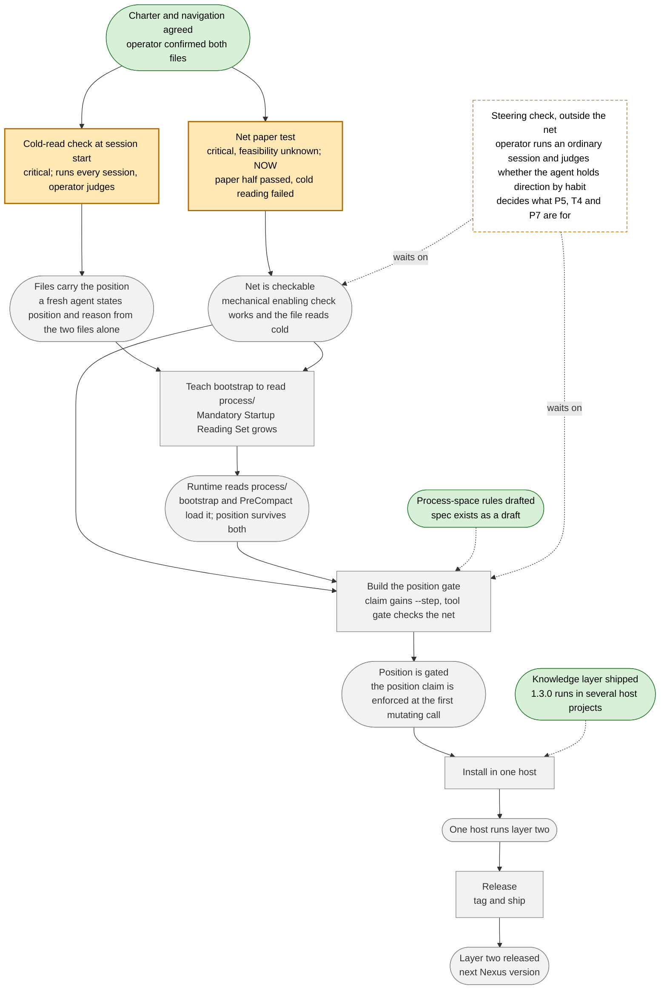

# Nexus net, as a picture

A rendering of `## Net` in `navigation.md` with names instead of ids. The navigation stays the source; this file is redrawn from it by hand and may lag. Experiment of 2026-10-08: whether a diagram makes the net readable cold where the list did not. `type: view` is not yet a kind in the process-space spec; the spec is amended if this file earns its place, and the file is deleted if it does not.

Reading the picture: rounded boxes are project states (places), rectangles are work (transitions). A transition fires only when every state feeding it is reached. Green is reached, orange is being worked, grey is ahead. "critical" means every path to the goal passes through it; "feasibility unknown" means we do not yet know whether it can be done at all.

Dotted edges from the first two states are not in the navigation's net: they show which reached states the far transitions rest on (the release goes to the hosts that run the first layer; the gate is built against the drafted rules). If they mislead, they go.
